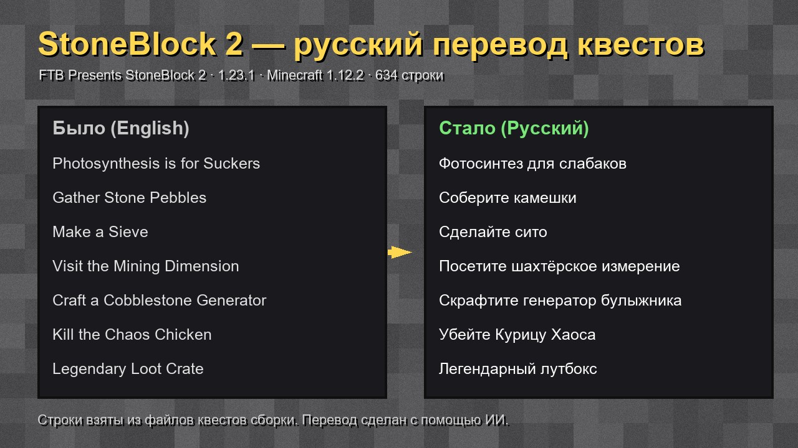

# StoneBlock 2 — русский перевод квестов

Полный русский перевод книги квестов (FTB Quests) для сборки **FTB Presents StoneBlock 2 версии 1.23.1** (Minecraft 1.12.2).

**Скачать:** [последний релиз](https://github.com/AnonioMF/stoneblock2-ru-quests/releases/latest)

**Это не мод**, а архив с файлами квестов (`config/ftbquests`). В папку `mods` его класть не нужно.

- переведены все 634 строки квестов: названия, задания, описания, главы, лутбоксы
- баланс и награды не изменены
- прогресс в уже созданном мире сохраняется

## Установка

1. Закройте игру.
2. В FTB App: правой кнопкой по сборке → Open Folder.
3. Сохраните копию папки `config/ftbquests`.
4. Распакуйте архив в папку сборки с заменой файлов.
5. В игре: Настройки → Язык → Русский.

Перевод сделан с помощью ИИ (Claude). Нашли ошибку — откройте Issue.

StoneBlock 2 и квесты принадлежат команде Feed The Beast. Репозиторий содержит только переведённые файлы квестов.

---

**English:** Russian translation of all quests in FTB Presents StoneBlock 2 (pack 1.23.1, MC 1.12.2). Download the zip from Releases and unzip it into the instance folder, replacing `config/ftbquests`. Rewards are unchanged. Made with AI assistance.
